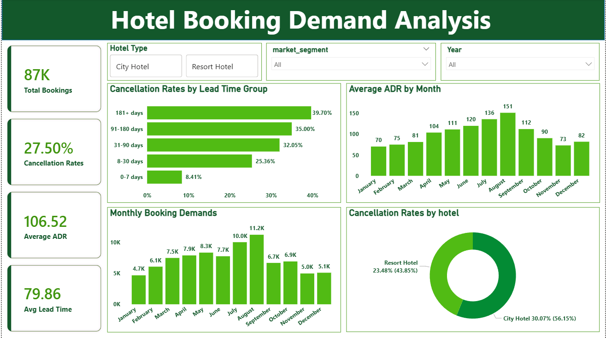

# Hotel Booking Demand Analysis

## Project Overview

This project analyzes hotel booking data to understand booking demand, cancellation behavior and pricing patterns.
Using Python, SQL and Power BI, the analysis identifies seasonal demand trends, high-risk booking periods and differences between City Hotel and Resort Hotel.

- Business Problem:
  We are experiencing booking cancellations and want to understand booking demand, cancellation behavior, revenue patterns, customer segments, and booking channels.

---

## Objectives

- Analyze monthly booking demand and identify peak and low-demand periods.

- Calculate overall and hotel-wise cancellation rates.

- Identify lead-time groups associated with higher cancellation rates.

- Analyze monthly Average Daily Rate (ADR) patterns.

- Provide actionable insights to support booking management, demand planning and pricing decisions.

---

## Tools & Technologies

- **Python:** Data cleaning and exploratory data analysis

- **Pandas:** Data manipulation

- **SQL:** Business data analysis

- **Power BI:** Interactive dashboard and visualization

- **Git & GitHub:** Version control and project documentation

---

## Key Insights & Business Recommendations

**Booking Demand**

- August recorded the highest booking demand at approximately 11.2K bookings, followed by July at 10.0K.

- January had the lowest demand at approximately 4.7K bookings.

- Recommendation: Plan staffing and room availability for peak months and consider targeted promotions during low-demand periods.

**Cancellation Behavior**

- The overall cancellation rate was 27.50%.

- City Hotel had a cancellation rate of 30.07%, compared with 23.48% for Resort Hotel.

- Bookings made 181 or more days in advance had the highest cancellation rate at 39.70%.

- Bookings made 0–7 days in advance had the lowest cancellation rate at 8.41%.

- Recommendation: Investigate cancellation patterns at City Hotel and consider targeted booking confirmations and cancellation-prevention strategies for long-lead-time bookings.

**Pricing Patterns**

- August had the highest average ADR at approximately 151, followed by July at 136.

- January had the lowest average ADR at approximately 70.

- Recommendation: Review pricing strategies during high-demand months and test suitable offers during quieter periods while monitoring profitability.

---

## Dashboard Features

- **KPI Cards:** Total bookings, cancellation rate, average ADR and average lead time.

- **Cancellation Rates by Lead Time Group:** Compares cancellation risk across different booking lead times.

- **Average ADR by Month:** Highlights monthly pricing patterns.

- **Monthly Booking Demand:** Identifies seasonal booking trends.

- **Cancellation Rates by Hotel:** Compares cancellation rates between City Hotel and Resort Hotel.

- **Interactive Slicers:** Filter the dashboard by hotel type, market segment, and year.

---

##Dashboard Preview

## Conclusion

The analysis highlights seasonal booking patterns, differences in hotel cancellation rates and an association between longer lead times and higher cancellation risk. These insights can help hotel managers prioritize cancellation analysis, improve demand planning, and evaluate pricing strategies.

Note: ADR represents the average daily rate not actual total revenue. The findings describe patterns in the analyzed dataset and do not independently establish the causes of cancellations.
